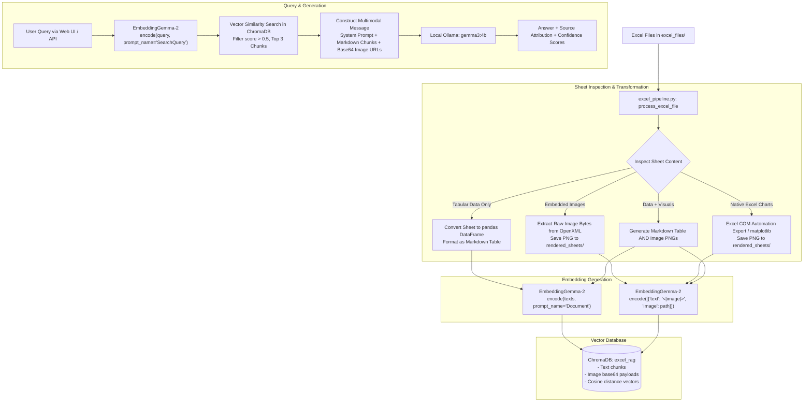

# Multimodal Excel Q&A & Semantic Search Pipeline

An end-to-end, local multimodal Retrieval-Augmented Generation (RAG) pipeline and web application designed to index and query complex Microsoft Excel (`.xlsx`) workbooks. It seamlessly extracts and embeds **tabular data**, **native Excel charts**, and **embedded technical diagrams/images**, allowing users to search and ask questions through a local browser UI powered by Google's `EmbeddingGemma 2` and Ollama's `gemma3:4b`.

---

## Table of Contents

- [Overview](#overview)
- [Key Features](#key-features)
- [Architecture & Workflow](#architecture--workflow)
- [Internal Implementation Details](#internal-implementation-details)
  - [1. Content Detection & Classification](#1-content-detection--classification)
  - [2. Extraction & Conversion Strategy](#2-extraction--conversion-strategy)
  - [3. What is Fed to the Embedding Model](#3-what-is-fed-to-the-embedding-model)
  - [4. Vector Storage & Persistence (ChromaDB)](#4-vector-storage--persistence-chromadb)
  - [5. What is Fed to the Generator LLM](#5-what-is-fed-to-the-generator-llm)
- [Repository Structure](#repository-structure)
- [Prerequisites](#prerequisites)
- [Installation & Setup](#installation--setup)
- [Running the Application](#running-the-application)
- [Testing & Validation](#testing--validation)
- [API Usage](#api-usage)
- [Sample Queries](#sample-queries)
- [Technical Q&A / FAQs](#technical-qa--faqs)

---

## Overview

Traditional RAG pipelines only extract raw text or flatten spreadsheets into unstructured text, losing relational structure, chart trends, and embedded visual assets. 

This pipeline treats Excel workbooks as **multimodal documents**:
- **Tabular Data** is converted into clean GitHub-Flavored Markdown (GFM) tables, preserving headers, rows, and cell alignments.
- **Embedded Pictures** (e.g., product schematics, photos, architectural drawings) are extracted losslessly from the OpenXML package.
- **Excel Native Charts** (e.g., bar charts, line graphs, scatter plots) are dynamically exported via Microsoft Excel COM automation into high-resolution, pixel-perfect PNG images with complete formatting and labels (with a headless `matplotlib` fallback).

Both text and visual representations are projected into a unified vector space using **EmbeddingGemma 2**, stored in a local **ChromaDB** vector store, and reasoned over by **Gemma 3 (4B)** running locally in Ollama.

---

## Key Features

- **100% Local & Private**: Embeddings, vector storage, and LLM inference run entirely on your local machine with no external API calls.
- **Unified Multimodal Search**: Retrieves both table markdown and visual snapshots together based on semantic relevance to the query.
- **Pixel-Perfect Chart Rendering**: Leverages Windows Excel COM (`win32com.client`) to snapshot charts directly from Excel's native rendering engine.
- **Lossless Image Extraction**: Extracts embedded diagrams and drawings directly from the worksheet package without loss of fidelity.
- **Hybrid Worksheet Support**: When a sheet contains both tables and visual charts/images, the pipeline generates both text and visual chunks so no information is lost.
- **Idempotent Ingestion**: Deterministic ID hashing prevents duplicate records on re-indexing.
- **Responsive Web UI**: Built-in HTTP server with an interactive chat interface showing answers, source attributions (`file :: sheet`), chunk type badges (`TABLE`, `IMAGE`, `CHART`), and relevance scores.

---

## Architecture & Workflow



---

## Internal Implementation Details

### 1. Content Detection & Classification

The pipeline uses `openpyxl` to inspect every worksheet in each `.xlsx` file:
- `_sheet_has_data(ws)`: Scans cell rows to check for non-null cell values.
- `_sheet_has_visuals(ws)`: Checks `ws._images` (embedded pictures) and `ws._charts` (chart objects).

### 2. Extraction & Conversion Strategy

| Content Type | How It Is Processed | Output Form |
|---|---|---|
| **Tables Only** | Extracted into a `pandas.DataFrame` and formatted as a Markdown table via `tabulate` (with a pure-Python table generator fallback). | Text chunk (`# <file> — <sheet>\n\n| Col | ... |`) |
| **Embedded Pictures** | Extracted from OpenXML image parts via `img_obj._data()`, opened with PIL, and saved as lossless RGB PNGs in `rendered_sheets/`. | Image chunk (`.png` file) |
| **Native Excel Charts** | On Windows, uses Excel COM automation (`win32com.client`) to open a background Excel instance and call `Chart.Export()`. If COM is unavailable, falls back to parsing series data from XML and re-plotting via `matplotlib`. | Image chunk (`.png` file) |
| **Hybrid (Data + Visuals)** | Both branches execute: table data is converted to Markdown, and visual elements are extracted/rendered into PNGs. | Multiple chunks (1 text + N images) |

### 3. What is Fed to the Embedding Model

The embedding model is **`google/embeddinggemma-2`** loaded via `sentence_transformers.SentenceTransformer`:

- **For Text (Tables)**:
  - Input: Markdown string containing file name, sheet title, and GFM table text.
  - Call: `model.encode(texts, prompt_name="Document", normalize_embeddings=True)`
  - Output: 2048-dimensional normalized dense vector.
- **For Visuals (Charts & Images)**:
  - Input: Multimodal input dictionary specifying the special image token:
    ```python
    inputs = [{"text": "<|image|>", "image": uri} for uri in uris]
    ```
  - Call: `model.encode(inputs, normalize_embeddings=True)` (no prompt name prefix).
  - Output: Dense vector in the same joint semantic embedding space.
- **For User Queries**:
  - Call: `model.encode(query, prompt_name="SearchQuery", normalize_embeddings=True)`

### 4. Vector Storage & Persistence (ChromaDB)

- **Vector Store**: `langchain_chroma.Chroma` configured with collection `excel_rag` and cosine metric (`{"hnsw:space": "cosine"}`).
- **Disk Location**: Stored in `chroma_db/`:
  - `chroma.sqlite3`: Relational database storing chunk text, document metadata (`source_file`, `sheet`, `type`), and image base64 strings.
  - `data_level0.bin`, `header.bin`, `length.bin`: Chroma's HNSW vector graph index.
  - `rendered_sheets/`: Directory storing all auto-generated PNG snapshots of charts and extracted images.
- **Deterministic Unique ID Scheme**:
  - Text chunks: `excel::text::<source_file>::<sheet>`
  - Image/Chart chunks: `excel::img::<png_path>`
  - This ensures that re-indexing does not duplicate vectors, and worksheets with multiple charts/images never collide.

### 5. What is Fed to the Generator LLM

When a user asks a question:
1. `vectorstore.similarity_search_with_relevance_scores(question, k=3)` retrieves the top matches scoring above `RELEVANCE_THRESHOLD = 0.5`.
2. A single multimodal `HumanMessage` is composed for `ChatOllama(model="gemma3:4b")`:
   ```python
   content = [
       {
           "type": "text",
           "text": "You are a data analyst. Answer the user's question using ONLY the Excel content provided below..."
       },
       # For Table chunks:
       {
           "type": "text",
           "text": "\n---\n**Source:** <file> :: <sheet>\n\n| Col1 | Col2 |\n|---|---|\n..."
       },
       # For Image / Chart chunks:
       {
           "type": "text",
           "text": "\n---\n**Source (<kind>):** <file> :: <sheet>"
       },
       {
           "type": "image_url",
           "image_url": {"url": "data:image/png;base64,<base64_data>"}
       }
   ]
   ```
3. Gemma 3 inspects the text tables and visual images simultaneously to formulate a grounded, factual answer.

---

## Repository Structure

```
multimodalembedding/
├── excel_files/             # Place your .xlsx input files here
├── rendered_sheets/         # Auto-generated PNG snapshots of charts & extracted images
├── chroma_db/               # Persistent ChromaDB vector store (SQLite + HNSW index)
├── web/                     # Web UI assets
│   ├── index.html           # Single-page interface with Markdown rendering & badges
│   └── style.css            # Styles for chat panel, cards, and metadata badges
├── .mpl_cache/              # Local cache directory for Matplotlib
├── excel_pipeline.py        # Core application: ingestion, embedding, RAG & HTTP server
├── test_excel_pipeline.py   # Dry-run validation script (mocks heavy models)
├── pyproject.toml           # Project dependencies and environment metadata
├── uv.lock                  # UV package manager lockfile
└── README.md                # Project documentation
```

---

## Prerequisites

1. **Python**: Version `3.13` or higher.
2. **Ollama**: Installed and running locally.
   - Pull the required multimodal chat model:
     ```sh
     ollama pull gemma3:4b
     ```
3. **Microsoft Excel (Recommended for Windows)**:
   - For pixel-perfect chart rendering via COM automation (`win32com.client`), Microsoft Excel must be installed.
   - If Excel is not installed, the pipeline automatically falls back to `matplotlib` re-drawing.

---

## Installation & Setup

1. **Clone or Navigate to the Repository**:
   ```powershell
   cd c:\Users\kotim\Downloads\multimodalembedding
   ```

2. **Activate the Virtual Environment**:
   ```powershell
   .venv\Scripts\activate
   ```

3. **Install Dependencies**:
   Using `pip` or `uv`:
   ```powershell
   python -m pip install -e .
   ```
   *Required packages include: `chromadb`, `langchain`, `langchain-chroma`, `langchain-ollama`, `sentence-transformers`, `torch`, `torchvision`, `openpyxl`, `pandas`, `tabulate`, `matplotlib`, `pillow`, `pywin32`.*

---

## Running the Application

1. **Add Your Excel Files**:
   Copy any number of `.xlsx` files into the `excel_files/` directory.

2. **Start the Pipeline**:
   ```powershell
   python excel_pipeline.py
   ```

   **What happens on startup**:
   - The `EmbeddingGemma 2` model is loaded into memory (uses GPU if supported, otherwise CPU).
   - All `.xlsx` files in `excel_files/` are parsed.
   - Tables are converted to Markdown and embedded as text vectors.
   - Charts are snapshotted to PNG and embedded as visual vectors.
   - Images are extracted to PNG and embedded as visual vectors.
   - All vectors and metadata are committed to `chroma_db/`.
   - The web server starts listening on `http://127.0.0.1:8000`.

3. **Open the Web UI**:
   Navigate to [http://127.0.0.1:8000](http://127.0.0.1:8000) in your web browser.

---

## Testing & Validation

To verify that your `.xlsx` files are correctly parsed without waiting for the large embedding models to load, run the dry-run test:

```powershell
python test_excel_pipeline.py
```

This script mocks heavy dependencies (`torch`, `sentence-transformers`, `chroma`, `ollama`) and outputs the exact chunks, kinds (`text`, `chart`, `image`), and character lengths that will be indexed.

---

## API Usage

The local server exposes an HTTP API compatible with standard JSON clients.

### Endpoint: `POST /ask`

#### Request:
- Content-Type: `application/x-www-form-urlencoded`
- Body: `question=<your_question>`

#### PowerShell Example:
```powershell
Invoke-RestMethod -Method POST -Uri http://127.0.0.1:8000/ask `
  -ContentType "application/x-www-form-urlencoded" `
  -Body "question=What were the monthly revenue trends in the sales report?"
```

#### cURL Example:
```sh
curl -X POST http://127.0.0.1:8000/ask \
  -H "Content-Type: application/x-www-form-urlencoded" \
  -d "question=Which department has the highest employee count?"
```

#### Response Format:
```json
{
  "answer": "Based on the Department Summary in 01_Employee_Data_Test.xlsx, the Engineering department has the highest count with 42 employees...",
  "retrieved": [
    {
      "label": "01_Employee_Data_Test.xlsx :: Department Summary",
      "score": 0.842,
      "kind": "table"
    },
    {
      "label": "01_Employee_Data_Test.xlsx :: Employees",
      "score": 0.761,
      "kind": "table"
    },
    {
      "label": "02_Sales_Charts_Test.xlsx :: Monthly Sales",
      "score": 0.589,
      "kind": "chart"
    }
  ]
}
```

---

## Sample Queries

Depending on the contents of your spreadsheets, you can test with questions such as:

### Tabular Inquiries
- *"List all employees in the Sales department and their job titles."*
- *"What is the total quantity of parts listed in the Mechanical BOM?"*
- *"Which products generated more than $50,000 in Q2?"*

### Visual & Chart Analysis
- *"What does the monthly revenue trend look like in the sales chart?"*
- *"Are sales increasing or decreasing between March and June?"*
- *"Describe the conveyor drive assembly shown in the mechanical drawing."*
- *"What part number corresponds to callout item 3 in the diagram?"*

---

## Technical Q&A / FAQs

#### Q1: Why were native Excel charts initially low quality compared to embedded images?
**A**: Excel stores embedded pictures as raw binary files (`.png`, `.jpg`) inside the `.xlsx` package, allowing 100% lossless extraction. However, Excel charts are stored purely as XML instructions and series cell references (no raster image exists). Re-plotting charts with `matplotlib` discards Excel styling, formatting, and custom labels. The pipeline addresses this by utilizing Windows Excel COM automation (`win32com.client`) to export native, pixel-perfect PNG renders directly from Excel.

#### Q2: Where are the generated assets stored?
- Rendered chart PNGs and extracted images: `rendered_sheets/`
- Base64 image strings, table Markdown text, and chunk metadata: `chroma_db/chroma.sqlite3`
- Vector index representations: `chroma_db/*.bin`

#### Q3: Does re-running the pipeline create duplicate embeddings?
**A**: No. Chunks utilize deterministic ID strings:
- Tables: `excel::text::<file>::<sheet>`
- Images & Charts: `excel::img::<path_to_png>`
Re-running the indexer overwrites or updates existing records rather than appending duplicates.

#### Q4: Can I add new Excel files without clearing the database?
**A**: Yes. Place new `.xlsx` workbooks into `excel_files/` and restart `excel_pipeline.py`. The new files will be processed, embedded, and added to the existing Chroma collection.
